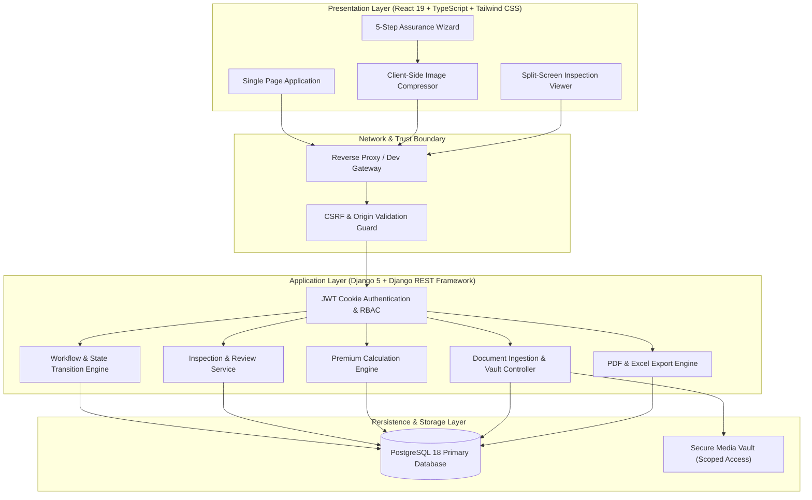

# Kevin Assurance

An enterprise assurance issuance and underwriting workflow management platform for motorcycle vehicle coverage. The platform standardizes multi-party operations across dealerships, field agents, underwriters, and executive administrators with strict multi-tenant role-based access control, automated conditional document ingestion, real-time inspection review pipelines, and ISO/IEC aligned security architecture.

---

## Executive Summary

Manual assurance issuance in the automotive distribution sector frequently suffers from lost physical records, typographical errors in national identification numbers (NIK), mismatched document requirements between new and used vehicles, and privacy leaks from unmanaged communication channels.

Kevin Assurance provides an integrated, end-to-end digital underwriting portal that:
- Eliminates document loss and intake bottlenecks through automated conditional document requirements.
- Accelerates issuance turnaround times from days to under 15 minutes.
- Guarantees data privacy and compliance aligned with ISO/IEC 27001 (Information Security) and ISO/IEC 27701 (Privacy Information Management).
- Enforces data integrity through strict server-side calculation engines and atomic multi-tier review state machines.

---

## Key Engineering Metrics

| Metric | Achievement | Description |
|---|---|---|
| **Backend Test Suite** | 245+ Passing Tests | Automated test suite covering PostgreSQL 18 and SQLite runtimes |
| **Frontend Verification** | 46 Automated Checks | Automated browser verification covering auth, wizard, and RBAC flows |
| **Role Hierarchy** | 4 Distinct Personas | Super Admin, Admin (Underwriter), Agent, and Dealer |
| **Payload Optimization** | ~80% Size Reduction | Client-side HTML5 Canvas compression before network ingestion |
| **Session Security** | 0 Browser PII Exposure | HttpOnly cookies, CSRF token rotation, zero tokens in localStorage |

---

## System Architecture



---

## Core Capabilities & Features

### 1. Intelligent 5-Step Assurance Wizard
The application intake workflow is organized into an intuitive multi-step wizard backed by explicit draft persistence:
- **Step 1 - Dealer Context:** Scoped to the authenticated dealer or selectable by authorized agents and administrators.
- **Step 2 - Policyholder Information:** Strict validation of customer name, 16-digit Indonesian National ID (NIK), contact details, and address.
- **Step 3 - Vehicle Specifications:** Dynamic capture of vehicle make, model, frame/engine numbers, and registration year.
- **Step 4 - Assurance Coverage & Pricing:** Automated selection between Total Loss Only (TLO), TLO+, and Comprehensive Plus (Kompre+), with server-authoritative premium and administrative fee calculations.
- **Step 5 - Conditional Document Uploads:** Dynamic requirements engine that switches validation rules based on vehicle status:
  - *New Motorcycle (Motor Baru):* Delivery Order (Surat Jalan) intake.
  - *Used Motorcycle (Motor Lama/Bekas):* Vehicle Registration Certificate (STNK) plus mandatory 4-angle physical condition photographs (Front, Rear, Right, Left).

### 2. Client-Side Image Compression Engine
To prevent bandwidth exhaustion and memory limits during mobile field operations, document uploads are processed through an in-browser HTML5 Canvas compression utility:
- Automatically scales high-resolution mobile camera captures to optimized dimensions while preserving text and license plate legibility.
- Converts uncompressed camera files to optimized JPEG format with measurable size reduction of up to 80% prior to transmission.

### 3. Multi-Tier Underwriting Review Pipeline
Underwriting workflows support structured collaboration between field agents, underwriters, and administrators:
- **Pre-Inspection & Review Notes:** Field agents review submissions from their assigned dealers, flag specific data fields or document defects, and request targeted revisions.
- **Revision History:** Dealers view flagged fields and document slots with historical defect notes, updating only necessary items without starting over.
- **Final Adjudication:** Admin and Super Admin users access a dedicated split-screen inspection viewer showing structured customer data alongside pan-zoom document previews to issue approvals, revision requests, or final rejections.

### 4. Enterprise Security & Privacy Architecture
- **HttpOnly Cookie Authentication:** JWT tokens are maintained exclusively within secure, HttpOnly, SameSite cookies. No authentication tokens, session identifiers, or personally identifiable information (PII) are ever persisted in browser `localStorage` or `sessionStorage`.
- **CSRF Token Rotation & Origin Verification:** Dedicated CSRF middleware verifies incoming HTTP Origin and Host headers, rotating anti-forgery tokens upon authentication transitions to defend against cross-site request forgery.
- **Media Vault Access Control:** Uploaded document files are stored outside direct web roots, requiring authenticated, role-scoped API calls for retrieval and preview.
- **Audit Trails:** Critical state transitions, review comments, and administrative decisions are recorded with timestamps, user IDs, and transition metadata.

### 5. Automated Reporting & Certificate Generation
- **PDF Certificate Generation:** Server-side PDF generation using ReportLab compiles comprehensive assurance certificates for approved policies.
- **Multi-Sheet Excel Reporting:** Dynamic workbook generation using `openpyxl` aggregates operational data, fee structures, and dealer distribution reports.

---

## Technology Stack

### Backend Infrastructure
- **Language & Framework:** Python 3.12, Django 5.2, Django REST Framework 3.18
- **Authentication:** SimpleJWT (Cookie-Based), Custom CSRF Protection Middleware
- **Database:** PostgreSQL 18 (Production & Integration), SQLite (Unit Test Suite)
- **Document & Media Processing:** Pillow 13.0, ReportLab 5.1, openpyxl 3.1
- **Architectural Standards:** Domain-driven service/selector pattern, ISO/IEC 25010 maintainability guidelines

### Frontend Application
- **Language & Runtime:** TypeScript 7, React 19, Vite 8
- **Styling & Design System:** Tailwind CSS v4, Lucide React Icons
- **State & Forms:** Custom React Hooks, Zod Schema Validation, Native Browser Dialogs
- **HTTP Client:** Axios with explicit interceptors for CSRF handling and credential pass-through
- **Code Quality:** Oxlint, TypeScript strict mode

---

## Project Structure

```text
kevin-assurance/
|-- backend/
|   |-- apps/
|   |   |-- assurances/            # Assurance domain: models, workflow, inspection, selectors
|   |   |   |-- migrations/        # Schema migrations including review workflow
|   |   |   |-- selectors/         # Query optimization and role-based filtering
|   |   |   |-- services/          # WorkflowService and InspectionService business logic
|   |   |   |-- models.py          # Core Assurance, Document, and Review models
|   |   |   |-- serializers.py     # DRF serializers with conditional validation
|   |   |   |-- views.py           # REST API endpoints and document handlers
|   |   |   +-- workflow_views.py  # Underwriting and review transition endpoints
|   |   +-- users/                 # RBAC: authentication, profile models, CSRF utilities
|   |       |-- authentication.py  # Cookie-backed JWT authenticator
|   |       |-- csrf.py            # Origin check and CSRF rotation helpers
|   |       +-- permissions.py     # Role authorization guards
|   |-- core/                      # Project settings, URL routing, exception handlers
|   |-- requirements.txt           # Core runtime dependencies
|   +-- requirements-dev.txt       # Development and testing dependencies
|-- frontend/
|   |-- src/
|   |   |-- auth/                  # AuthContext, ProtectedRoute, authentication hooks
|   |   |-- components/
|   |   |   |-- assurances/        # Assurance listing, filters, and summaries
|   |   |   |-- documents/         # Upload slots, checklist, conditional uploader
|   |   |   |-- layout/            # Responsive sidebar, navigation, mobile drawer
|   |   |   |-- master/            # User, dealer, and assignment management dialogs
|   |   |   |-- review/            # Split-screen viewer, inspection panel, review progress
|   |   |   |-- shared/            # Data tables, confirm dialogs, feedback badges
|   |   |   +-- wizard/            # 5-step application wizard and unsaved guards
|   |   |-- hooks/                 # Custom domain hooks (useInspection, useWizardSession)
|   |   |-- pages/                 # Route pages (Dashboard, Assurances, Review, Admin)
|   |   |-- schemas/               # Zod validation schemas
|   |   |-- services/              # API clients for assurances, documents, and downloads
|   |   |-- styles/                # Modular CSS files (shell, forms, review, content)
|   |   +-- utils/                 # Image compressor, date formatters, status labels
|   |-- package.json               # Frontend dependencies and npm scripts
|   +-- vite.config.ts             # Vite build configuration and dev proxy setup
|-- docs/                          # Comprehensive engineering specifications & diagrams
|   |-- 01_BRD.md                  # Business Requirements Document
|   |-- 02_PRD.md                  # Product Requirements Document
|   |-- 03_Insurance_Products.md   # Insurance product specifications
|   |-- 04_SRS.md                  # Software Requirements Specification
|   |-- 06_TDD.md                  # Technical Design Document
|   |-- 07_Database.md             # Data dictionary and schema definitions
|   |-- 08_API.md                  # REST API contract specifications
|   +-- diagrams/                  # Mermaid system diagrams
+-- README.md                      # Project portfolio overview
```

---

## Key Code Highlights

### 1. Robust Domain Services
- [`WorkflowService`](file:///d:/Self%20Project/Kevin-Assurance/backend/apps/assurances/services/workflow_service.py): Manages assurance state transitions (`DRAFT` -> `SUBMITTED` -> `UNDER_REVIEW` -> `ACTIVE` / `REVISION` / `REJECTED`) with permission validation and atomic database transactions.
- [`InspectionService`](file:///d:/Self%20Project/Kevin-Assurance/backend/apps/assurances/services/inspection_service.py): Powers the underwriting inspection workflow, recording item-level defect flags and notes on specific data fields and uploaded document slots.

### 2. Front-End Architecture & State
- [`AssuranceWizard`](file:///d:/Self%20Project/Kevin-Assurance/frontend/src/components/wizard/AssuranceWizard.tsx): Orchestrates the 5-step issuance flow with unsaved changes guards and server-side fee recalculation.
- [`SplitScreenViewer`](file:///d:/Self%20Project/Kevin-Assurance/frontend/src/components/review/SplitScreenViewer.tsx): Provides an interactive dual-pane review interface enabling underwriters to evaluate policy details alongside high-resolution document previews.
- [`imageCompressor`](file:///d:/Self%20Project/Kevin-Assurance/frontend/src/utils/imageCompressor.ts): Client-side image canvas pipeline ensuring rapid uploads while guaranteeing legible inspection standards.

---

## Local Development & Setup

### Prerequisites
- Python 3.12 or newer
- Node.js 20 or newer (with npm)
- PostgreSQL 18 (or SQLite for standard local development)

### Backend Setup
1. Navigate to the backend directory:
   ```bash
   cd backend
   ```
2. Create and activate a Python virtual environment:
   ```bash
   python -m venv venv
   # Windows:
   .\venv\Scripts\activate
   # Linux/macOS:
   source venv/bin/activate
   ```
3. Install dependencies:
   ```bash
   pip install -r requirements.txt
   pip install -r requirements-dev.txt
   ```
4. Run database migrations:
   ```bash
   python manage.py migrate
   ```
5. Start the development API server:
   ```bash
   python manage.py runserver 127.0.0.1:8000
   ```

### Frontend Setup
1. Navigate to the frontend directory:
   ```bash
   cd frontend
   ```
2. Install dependencies:
   ```bash
   npm ci
   ```
3. Start the Vite development server:
   ```bash
   npm run dev
   ```
4. Access the application in your browser at `http://127.0.0.1:5173`.

---

## Verification & Automated Test Suites

### Running Backend Tests
Execute the full test suite with coverage across all domain modules:
```bash
cd backend
python -m pytest apps/assurances/ tests/ --verbose
```
Or run targeted verification suites:
```bash
python manage.py test apps.assurances.test_inspection
python manage.py test apps.assurances.test_filters
python manage.py test apps.users.test_csrf_diagnostics
```

### Running Frontend Checks
Validate TypeScript compilation and lint rules:
```bash
cd frontend
npm run build
npm run lint
```

---

## Engineering Standards & References

The system was designed and verified against established engineering and software quality standards:
- **ISO/IEC 25010:2023:** Systems and software Quality Requirements and Evaluation (SQuaRE).
- **ISO/IEC 27001:2022 & ISO/IEC 27701:2025:** Information security management and privacy information protection principles.
- **OWASP Top 10:** Comprehensive defenses against Cross-Site Scripting (XSS), Cross-Site Request Forgery (CSRF), and Broken Access Control.
